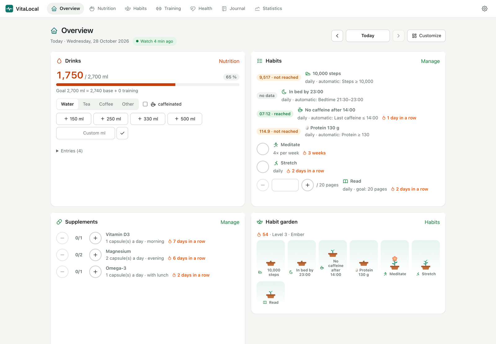
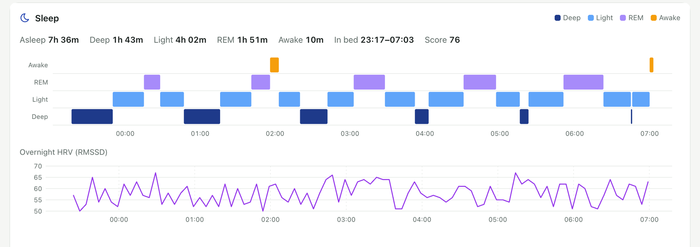
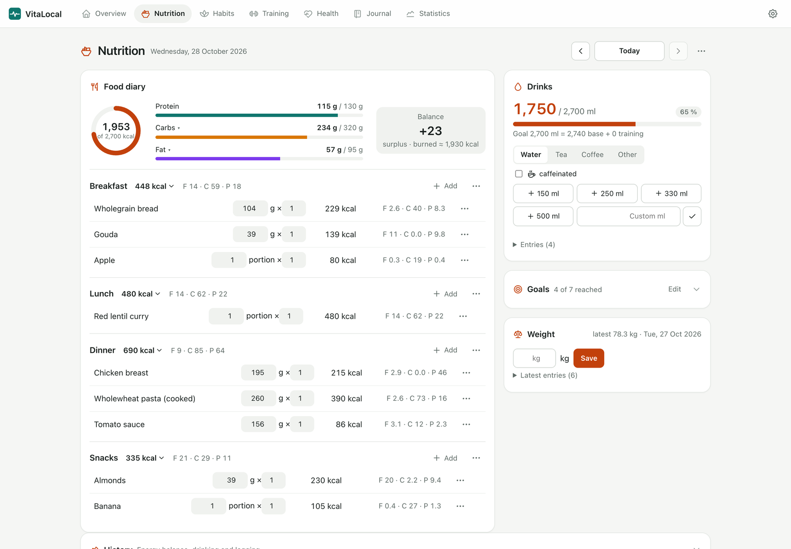
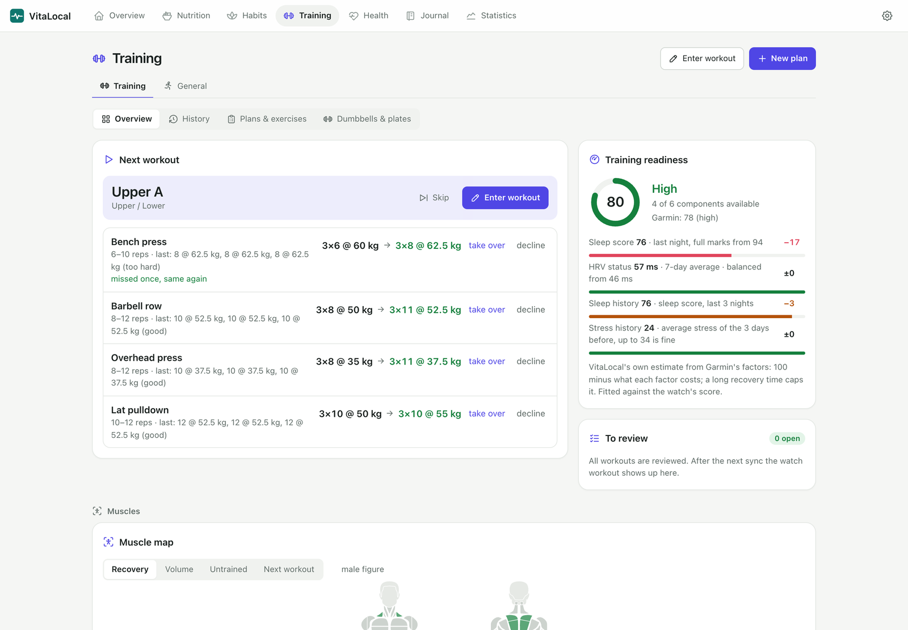
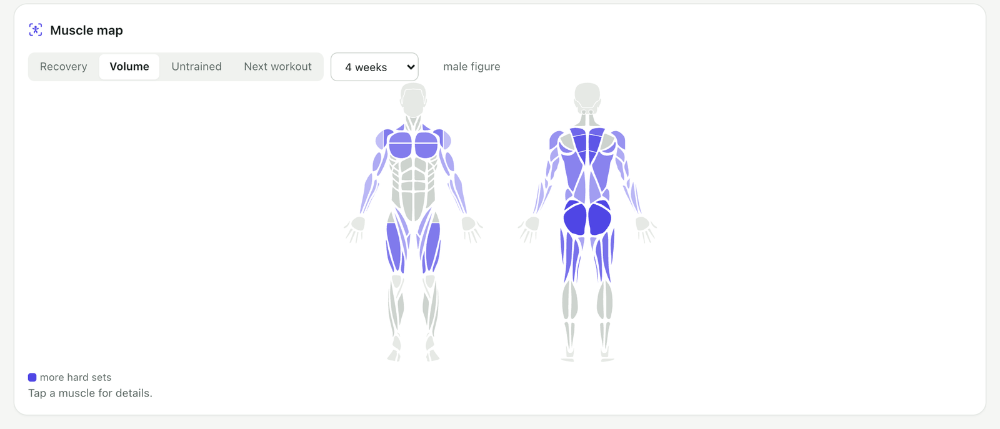
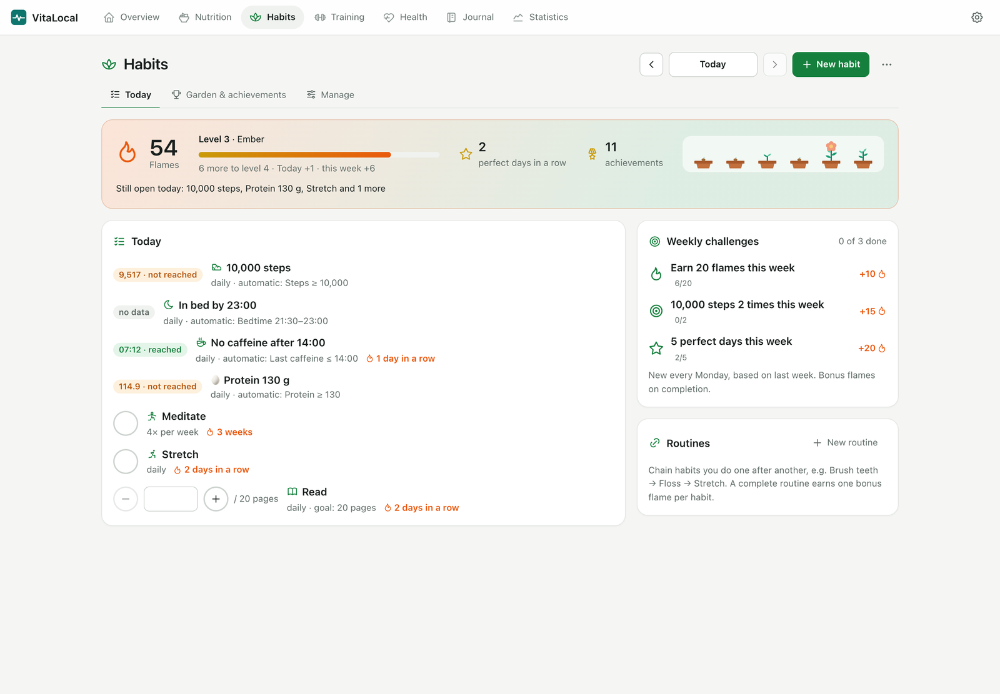
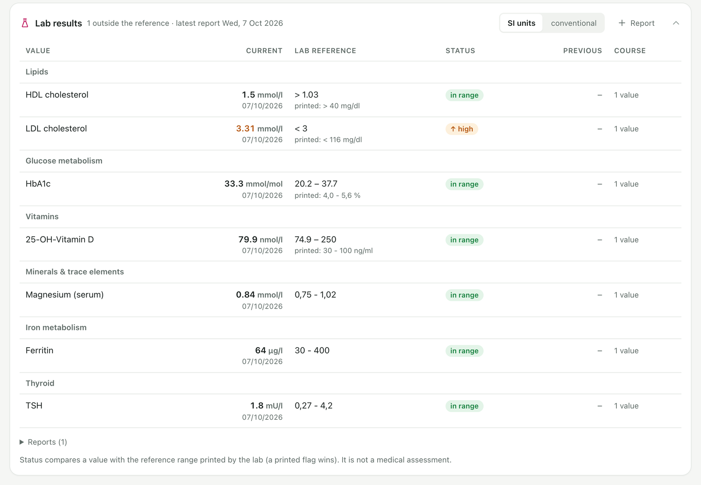
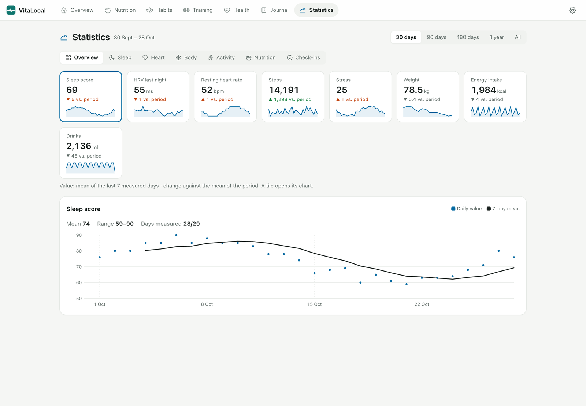
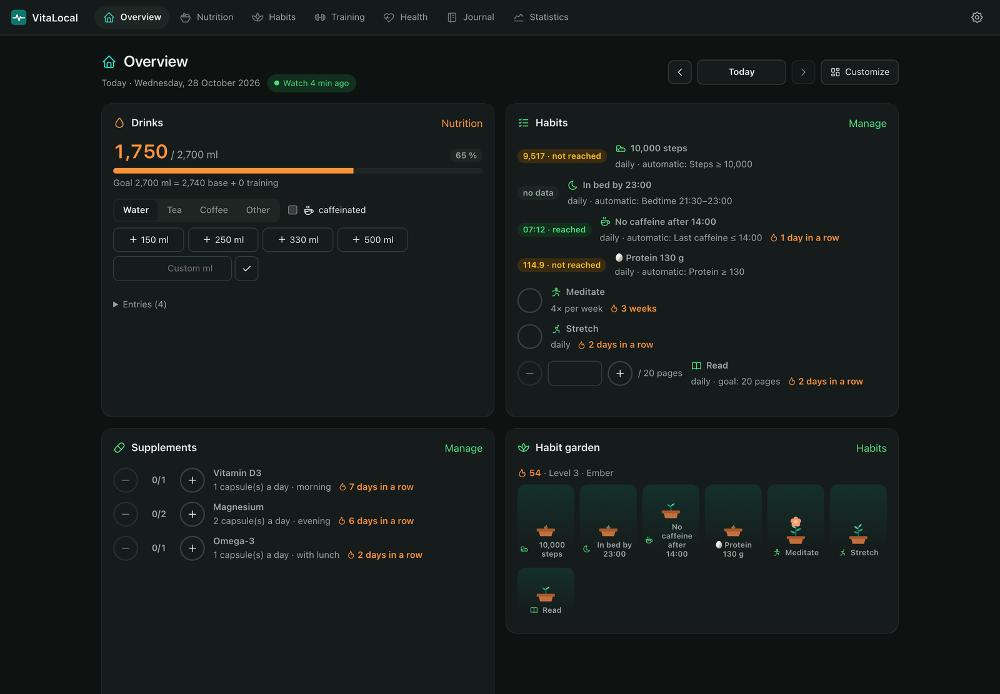
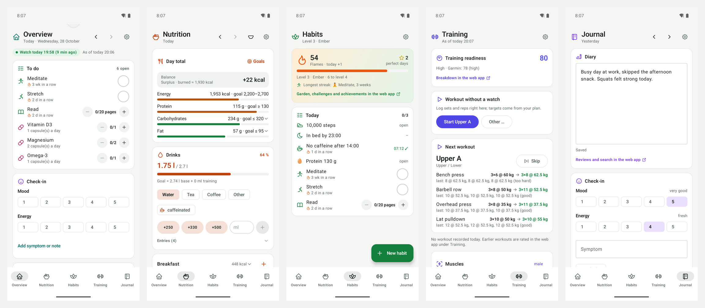

# VitaLocal

Self-hosted health diary: food, drinks, training, habits, journal, lab results and – if you have
one – the data of your watch, on your own server. A WebUI for everything and an Android app for
logging on the go. Works without a watch and without AI; both are optional.

> **Not medical advice.** VitaLocal shows and estimates values from your data. Estimates, AI texts
> and lab status can be wrong; talk to a doctor about health questions.

## Screenshots

All values are invented demo data (`tools/demo_data.py`, see [Development](#development)).

<p align="center"></p>

| | |
|---|---|
|  |  |
| Sleep stages and overnight HRV from the watch | Food diary against your goals, energy balance |
|  |  |
| Next workout with double progression, training readiness | Muscle map: recovery, volume, untrained muscles |
|  |  |
| Habits, automatic ones from your data | Lab results, SI or conventional units |
|  |  |
| Statistics with a 7-day mean | Dark mode |

**Android app** – logging on the go and a short overview; the details stay in the WebUI:



## What you need

- A machine that runs Docker (a NAS, a mini PC, a VPS, …).
- Optional: an Android phone for the app, a watch that [Gadgetbridge](https://gadgetbridge.org)
  supports, or any app that writes to Health Connect (Samsung Health, Fitbit, Google Fit, …).
- Optional: an AI model – in your network (Ollama, LM Studio, llama.cpp, vLLM) or a hosted
  provider (OpenAI, Anthropic, Google Gemini, Mistral, OpenRouter).

## Install

```bash
git clone https://github.com/erryKinq/VitaLocal.git vitalocal && cd vitalocal
cp .env.example .env        # set POSTGRES_PASSWORD and VITALOCAL_API_TOKEN (openssl rand -hex 32)
```

Then either use the published image (amd64 and arm64, from the
[releases](https://github.com/erryKinq/VitaLocal/releases)): set
`VITALOCAL_IMAGE=ghcr.io/errykinq/vitalocal:latest` (or a release such as `:2026.10.28`) in `.env` and

```bash
docker compose pull && docker compose up -d
curl localhost:8000/health
```

or build it yourself: `docker compose up -d --build`.

Open `http://<host>:8000/`, enter the API token (it is your login, remembered per browser) and
follow the setup: language and units, your body data (for the energy estimate), where your
measurements come from, a goal, AI (optional) and which areas you want to see. Everything can be
changed later under ⚙︎ Settings.

The API listens on `127.0.0.1` only. To reach it from other devices either put a reverse proxy
with HTTPS in front (recommended) or set `VITALOCAL_BIND` to the LAN/VPN address.

### HTTPS with a reverse proxy

Example with [Caddy](https://caddyserver.com) on the same host (automatic certificates for a
public name; for a LAN-only name use `tls internal` and trust Caddy's root certificate on your
devices):

```
vita.example.org {
    reverse_proxy 127.0.0.1:8000
    request_body {
        max_size 512MB   # Gadgetbridge exports can be large
    }
}
```

The Android app accepts plain `http://` only for addresses in the local network or a VPN
(private IPs, `.lan`, `.local`, `.home`, `.internal`, `.arpa`).

### Updating

With the published image: `git pull` (for changes to `docker-compose.yml`), then
`docker compose pull && docker compose up -d`. Building yourself: `git pull && docker compose up -d --build`.
Migrations run on start; back up first (below).

### Backup and restore

Two Docker volumes hold everything: `pgdata` (the database) and `raw_store` (uploaded files and
the key that encrypts a stored AI API key). Back up both, e.g. nightly:

```bash
docker compose exec -T db pg_dump -U vitalocal -d vitalocal -Fc > vitalocal-$(date +%F).dump
docker run --rm -v vitalocal_raw_store:/data -v "$PWD":/backup alpine tar czf /backup/raw_store-$(date +%F).tgz -C /data .
```

Restore into a fresh install: `docker compose up -d db`, then
`docker compose exec -T db pg_restore -U vitalocal -d vitalocal --clean --if-exists < vitalocal-….dump`
(TimescaleDB may print harmless warnings), unpack the raw store into its volume, start the API.

Besides that, Settings → Data & import → **Export** downloads all your data as a ZIP of CSV files
(every table, plus readable files for food diary, body values, strength sets and daily values).

## Where the data comes from

- **Logged by you** (web or app): food (own catalog, Open Food Facts, barcode scan), drinks,
  weight and body measurements, workouts and sets, habits, supplements, journal, lab reports.
- **A watch via Gadgetbridge**: the app uploads Gadgetbridge's exports (and, with live sync, its
  database every few minutes). Developed with a Garmin watch; other Gadgetbridge devices bring
  what Gadgetbridge records for them. Setup: [android/README.md](android/README.md).
- **Health Connect** (Android): steps, energy, sleep, weight, heart rate and workouts that other
  apps write there. Choose it in the app under Settings → Data source.
- **No watch**: the daily burn is estimated from your profile (Mifflin-St Jeor × activity level,
  or your own daily burn) plus your workouts (duration, type and how hard they were). Shown as
  "≈ estimated".
- **Imports** (Settings → Data & import, detected from the file): Gadgetbridge ZIP, Waistline
  JSON/CSV, workouts from **Strong** or **Hevy** (CSV), daily values from **MyFitnessPal**,
  **Cronometer** or any CSV with a date column (calories, macros, weight, body fat).

## AI (optional)

Settings → AI takes any OpenAI-compatible endpoint. Without it, all AI features are hidden.
With it: day/week summaries, a training coach (plan from a questionnaire, plan review, workout
debriefs) and reading lab reports from PDFs/photos (needs a model that reads images).

The model never queries the database; VitaLocal sends a prepared fact sheet. With a **hosted
provider** your data leaves your server: the settings show what is sent and let you allow it per
feature. Journal text and lab reports are not shared with an external model unless you allow it.
API keys are stored encrypted.

## Android app

Every [release](https://github.com/erryKinq/VitaLocal/releases) carries the signed APK
(`VitaLocal-<version>-<code>.apk`). Your server fetches it on its own: under Settings → Android app,
**Updates from GitHub releases** is on by default and checks the latest release of
`erryKinq/VitaLocal` once a day (or on "Check now"). An APK with a higher version code than the
published one is downloaded, verified against the release's `.sha256` file and published on your
server; installed apps then update themselves from there. The card shows the last check and its
result. Switch it off (or point it at your fork's repository) if you publish builds yourself; while
off, the server makes no requests to GitHub. Without it, upload the APK of a release on the same
page. In the app enter the server address and the API token; you can also download the APK there on
the phone for the first install. Building it yourself: [android/README.md](android/README.md)
(note: updates only install over an app signed with the same key).

## Watch app (Garmin, optional)

`watch/` holds a small Connect IQ app for logging drinks, weight, supplements and habits on the
wrist, with a glance and a background sync. For now it is designed for the **Garmin Venu 4**
(41/45 mm) only; other watches are not supported yet. It talks to the server through Gadgetbridge
(allow the server's host in Gadgetbridge's internet firewall for the device). Build it with
`watch/build.sh` (needs the Connect IQ SDK and a developer key; the server address and token are
compiled in from `.env`, see the top of the script) and install the `.prg` with Gadgetbridge.
The rest of VitaLocal does not need it.

## Languages and units

German and English (web: browser language by default; app: phone language). Metric or imperial
body weight and height (training weights are in kg).

## Principles in the code

- **Raw store** (`server/src/vitalocal/rawstore.py`): every archive entry, including nested backup ZIPs,
  is stored write-once under its SHA-256. Re-uploading identical bytes yields the same batch.
- **Retention** (`server/src/vitalocal/ingest/retention.py`): exports are full snapshots, so once a
  newer export of the same source is in, an older one's bytes are dropped after
  `VITALOCAL_RAW_RETENTION_DAYS` (default 7). Only files with a newer version go; files that exist
  only in old exports (e.g. a FIT deleted on the phone) and all imported data stay. The latest
  successful export per source is always kept. Pruned batches can't be reprocessed.
- **Versioned parsers**: each run lands in `parse_run` (parser name/version, statistics).
  `POST /api/v1/ingest/batches/{id}/reprocess` replays the preserved raw data.
- **One import at a time** (`server/src/vitalocal/ingest/worker.py`): uploads queue up and a
  background worker processes them oldest first; after a restart interrupted imports run again.
  FIT files already parsed by the current parser version are skipped.
- **Incremental, never backwards** (`ingest/gb_state.py`): a Gadgetbridge database is parsed per
  table from the previous snapshot's newest row minus 72 h (`VITALOCAL_GB_WINDOW_HOURS`), so an
  import costs the same whatever the history; once a night the latest snapshot is parsed in full
  and any difference older than the window is reported as `drift`. An export taken before the
  applied one (uploaded late) is not parsed, so it cannot overwrite newer data.
- **No fake values**: Gadgetbridge sentinels (`-1`, heart rate `0`) are counted as `missing`, not
  stored. Unverified semantics keep raw `gb.*` metric names.
- **Visible data quality**: `/api/v1/quality/reconciliation` (FIT ↔ DB summaries, empty/unknown
  tables, FIT CRC errors), `/api/v1/quality/coverage` (samples and largest gap per day) and
  `/api/v1/quality/activity-sets` (FIT sets vs. Gadgetbridge's set table, row by row).
- **Two sources, one activity**: the Gadgetbridge summary and the FIT session merge on
  device + start time; activities that exist only as FIT (e.g. Pilates) are created from the FIT.
  `/api/v1/activities/{id}` returns all sets including rest sets.

## WebUI

Static ES modules under `server/src/vitalocal/web/`, served by FastAPI. No build step, no external
CDN, and hand-built SVG charts, so it works offline in the LAN.

- **Day**: opens today ("Heute"/"Gestern"/"Vorgestern" between the arrows; the label opens the
  date picker) with the data freshness (watch data until …, last sync per source). Today's page
  follows new data: it checks `/api/v1/ingest/status` every minute and redraws in place when an
  import finished (while you edit something it offers a refresh link instead). The page is a
  set of widgets you can add, remove, reorder (drag or arrows) and size ("Anpassen"); today and
  past days have separate layouts, stored on the server. Widgets: drinks, habits, KPIs against a
  28-day median, AI summary, sleep (hypnogram, overnight HRV), nutrition, journal, heart rate,
  stress/body energy, steps, SpO₂, respiration, activities, and derived insights: training
  readiness (own transparent heuristic), sleep rhythm (average bed/wake times, regularity, weekly
  trend), recovery after training, energy averages and a weekly trend table. On Sundays and on the
  last day of a month the weekly/monthly review appears next to the journal. Low heart-rate
  coverage is flagged.
- **Trends**: selectable metrics, daily values plus a 7-day rolling mean. Gaps stay gaps.
- **Activities**: list, plus a detail page with sets (rest periods optional), exercise summary and
  heart rate.
- **Journal**: quick check-ins (mood, energy, symptoms, notes) and a daily journal with autosave;
  weekly review on Sundays and monthly review on the last day of a month, each with the period's
  numbers. Writes carry a version, so a text changed meanwhile elsewhere (an agent, the app, another
  browser) is never overwritten silently: keep mine / take theirs / combine. Earlier versions can
  be restored; full-text search over entries, reviews and notes. Check-in IDs are generated by the
  client, so resubmitting is idempotent.
- **Activities** also take corrections: "Correct sets" lets you change exercise, exact exercise
  (FIT names), reps and weight. Corrections are a separate layer; watch values stay intact and
  corrections survive reprocessing. RPE (1–10) per workout.
- **Language & theme**: German or English (browser language by default), light/dark/system, via ⚙︎ in the header.
- **Habits**: tick off, count, or evaluated automatically from a daily value within a range
  (e.g. protein 120–180 g). Clock habits: bedtime and wake time within a window (from the watch's
  sleep; bedtime counts for the evening) and "no caffeine after 14:00" (from the drinks marked as
  caffeinated).
- **Training**: own exercise library (linked to the watch's exercise categories, muscles
  per exercise), plans with split days in rotation, review of each watch workout (plan day and
  exercise per set proposed, warm-up/accidental sets marked, missing sets added, each exercise
  rated too easy / good / too hard), manual workouts, double progression ("next time: 3×9 @ 15 kg",
  taken over with one click), hard sets per muscle group and week, estimated 1RM. The Android app
  shows the next workout.
- **Health**: supplements, taken X of Y units a day (day widget, Android card and widget), with
  active ingredients summed per day against the EFSA upper levels. Lab results: a table per
  analyte (latest value, lab reference as printed, status, previous value, course), SI or
  conventional units with conversion, personal target ranges. Reports are entered by hand (catalog
  autocomplete) or imported from a PDF/photo: the local vision model transcribes it, and every
  value is confirmed in a review next to the page before anything is saved. No AI assessment of
  the results in the UI; the day/week summary and agents (`GET /api/v1/labs/facts`) get them as data.
- **Nutrition**: food diary per meal (search in the own catalog while typing, Open Food Facts on
  demand, barcode field for typing or a USB scanner, portions, quick entries, "like yesterday",
  entries edited in place), a foods page (foods and dishes from ingredients), weight, drinks
  (water, tea, coffee, other, with a "caffeinated" switch; entries can be corrected later), goals
  (nutrient goals edited here, versioned; a daily drink goal from body weight plus training),
  intake vs. burned, logging heatmap. Waistline is replaced once from the Data page. Activities and Journal have consistency heatmaps too.
- **Data**: upload (Gadgetbridge ZIP, Waistline JSON/CSV, Strong/Hevy workouts, daily-value CSVs, detected automatically), export, coverage
  heatmap, reconciliation, FIT/Gadgetbridge set comparison, import history, Waistline takeover.

Note: a Waistline export contains app settings including credentials (e.g. the Open Food Facts
password). VitaLocal archives the file unchanged but never reads or exposes those fields; from the
settings it only reads meal names, units and goals.

Daily aggregation rules and labels live in `server/src/vitalocal/metrics.py`; day boundaries
use `VITALOCAL_TIMEZONE` (default `Europe/Berlin`).

## Development

```bash
cd server
uv sync
uv run pytest -m "not db"                         # pure unit tests
VITALOCAL_TEST_DATABASE_URL=postgresql+psycopg://user@host:5432/vitalocal_test uv run pytest
uv run python -m vitalocal.cli import ../data/Gadgetbridge.zip
```

**Demo data:** `python3 tools/demo_data.py --url http://localhost:8000 --token "$VITALOCAL_API_TOKEN"`
fills an **empty** instance with four weeks of invented data: a synthetic Gadgetbridge export (heart
rate, steps, sleep, stress, HRV, runs) through the normal import, plus food, drinks, weight, habits,
supplements, workouts, journal and one lab report through the API (Python 3.9+, stdlib only).

`db` tests **wipe** the schema of the given test database. `realdata` tests use
`data/Gadgetbridge.zip` (gitignored, never commit it) and are skipped if it is missing.
Without TimescaleDB the migration falls back to a plain PostgreSQL table.

**Releases:** a tag `vYYYY.MM.DD` (a second one that day: `vYYYY.MM.DD-2`) runs
`.github/workflows/release.yml`: it builds the server image for amd64 and arm64, pushes it to GHCR as
`:<date>` and `:latest`, builds the signed APK and attaches it to the GitHub release. Raise
`versionCode` in `android/app/build.gradle.kts` for every app change, otherwise phones do not update.
The workflow signs with the repository secrets `ANDROID_KEYSTORE_BASE64`, `ANDROID_KEYSTORE_PASSWORD`,
`ANDROID_KEY_ALIAS` and `ANDROID_KEY_PASSWORD` (a fork needs its own key, and its apps then update
only from its own releases).

## Third-party material

- Body outlines of the muscle map: [MuscleMap](https://github.com/melihcolpan/MuscleMap) by Melih
  Colpan, MIT License; converted with `tools/musclemap_to_json.py` into
  `server/src/vitalocal/web/body-paths.json` and `android/app/src/main/assets/body-paths.json`
  (each carries the license text).
- Icons: [Tabler Icons](https://tabler.io/icons), MIT License (`tools/icons/build.py`).

## License

[MIT](LICENSE): use, copy, change and share it freely, also in your own projects. Third-party
material keeps its own license (see above).
